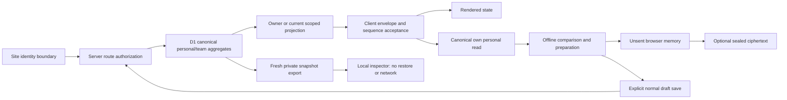

# HLD delta — actual implementation boundary

## Actual runtime

The checkout uses React/TypeScript UI with App Router-style handlers, a vinext/Vite/Sites Worker build path, trusted Site ChatGPT identity headers, Cloudflare `env.DB`/D1 persistence and Drizzle SQLite schema/migrations. Dependency versions are captured in source `package.json`; this is an observation, not a recommendation or claim of newest versions.

The original proposed PostgreSQL modular-monolith/OpenAPI-v1 design remains a reference artifact. The running-source model is aggregate JSON and D1 CAS with six actual method/path routes in [api-and-commands.json](api-and-commands.json), not100 implemented OpenAPI operations.

## Trust/data flow

Server authorization is authoritative. Client acceptance checks prevent an unrelated/malformed/late response being treated as current access but cannot create access. Identity fixture headers on a local Worker do not prove the public trusted-header boundary.

## Data boundary

Seven relational tables contain32 columns. Personal state belongs to server-derived owner; team canonical JSON contains retained membership, scoped learners, reviews and workbench state. Domain projections expose only current authorized views. Audit/action keys and revision CAS support mutation concurrency; detached history is separately permissioned.

Directory projection stores account/team pairs only. Its index is a discovery optimization; final metadata and roles come from matching canonical membership. Additive migration0005 creates schema and future-write triggers, with no existing-row data backfill. Legacy fallback means improvement is gradual, not an immediate all-workspace performance guarantee.

## New local capabilities

Snapshot export wraps exact saved JSON bytes, current revision and checksum. Inspector only diagnoses a private file; checksum is not signature or restore authority.

Own learning-help preferences and assistance declarations reuse canonical own aggregate state. No helper identity service, microphone/audio capture, new evidence sharing or translated publication is added. User-started read-aloud speaks exact text using an available matching local browser voice.

Offline reference is immutable public fictional seed material. Unsent text drafts and optional encrypted copies stay local. Explicit reconnect/save uses existing server commands and freshly accepted state; no background submission/synchronization or privileged offline action is added.

## Integration and readiness

Live AI is pending user credential choice. Partner readiness and record status are isolated candidates. Existing ecosystem interactions are bounded local simulations; no OAuth partner, outbound webhook/provider transport or recognized credential service is introduced by this sprint observation.

Root subsequently reports successful application of migration0005 to the isolated/local app DB (seven commands). This is separate from hosted/production migration. Final build, current-root integrated browser/API/regression, production migration, main merge and owner-private publication belong to root release acceptance. This document does not infer them from candidate tests or read-time source.
