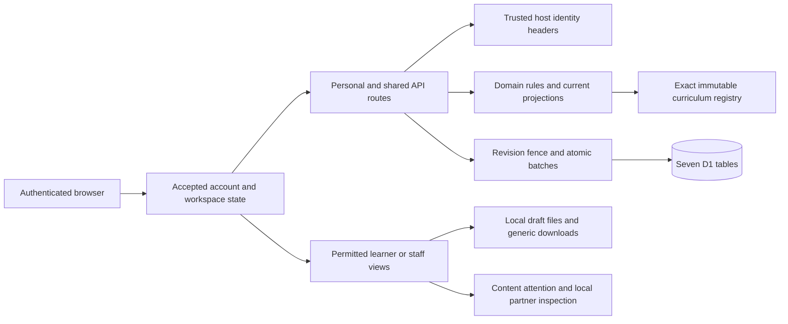

# Aplyd Academy implemented design

The working pilot teaches source-based job practice for farmer, MSME and public-service contexts. It records learner work, separates self practice from authenticated assigned review, and retains exact content and review history. The library and fictional job templates support careful use of supplied AI drafts; no live model or real ecosystem transport is implemented.

## Functional journeys

| Journey | Implemented behavior | Authority and boundary |
| --- | --- | --- |
| Personal practice | Own profile, global English draft pathways, lesson draft/completion, practical attempts, sample review and appeal, nonaccredited record, work reflection and own plan | Personal row belongs to the trusted current account. Sample assessor/reviewer labels are teaching fixtures. |
| Shared learning | Invite acceptance, open-cohort enrollment with capacity, pinned lessons, own submission, assigned assessment, independent appeal and retained own history | Current membership, learner role where required, exact cohort/content, assignment and independence are checked server-side. A paused cohort blocks learning/review but retains permitted appeal/withdrawal/history behavior. |
| Discussion | Scoped posts/replies enter pending moderation; visible or own material is projected; a scoped moderator publishes/hides with a reason | Cohort access is recalculated; moderator permission is scoped. Owner role alone does not moderate. |
| Networking | Opt-in own profile for permitted cohorts, scheduled cohort sessions, reservations/cancellations and host-recorded attendance history | Current board access, valid scoped host, time and capacity are enforced. Attendance is a workstream record, not a course award. |
| Support | Explicit shared intake, queue metadata, independent eligible claim, requester/assigned-handler replies, resolution, requester reopen/withdraw | Owners see queue metadata. Full body is for the requester and current eligible assigned handler. Learning/content facilitators require the selected cohort scope. Support cannot decide an appeal. |
| Owner authoring | Copy or job-template draft, author edits, assigned independent owner review, unchanged approved publication, archive and retirement | All content commands require a current owner. Author identity is retained; another owner cannot edit/recall as the author. Publication requires the exact approved document hash and current independent reviewer. |
| Inclusive/offline practice | Own language/read-aloud/help request, local voice after explicit action, learner-declared assisted capture, exact global lesson packets, sealed personal draft files, refresh/compare/explicit draft save | No translated course or helper authority is inferred. Offline import never submits/completes learning or grants a record. Authenticated application screens still need an online session. |
| Private records | Fresh own record check or currently assigned open-appeal original-decision check; thin downloadable status with checksum | Current saved row, exact revision and current projection are checked again. The checksum concerns that snapshot, not an issuer signature or later status. |
| Ecosystem workbench | Saved personal test choice, exact selected summary fields/expiry/pin, locally simulated receipt, read-only readiness inspection, generic discussion brief | No outbound partner call. Health has no learning mapping. Shared workspace learning does not become a personal return grant. |
| v0.13 owner/help presentation | Exact-edition content attention and continuity; unchecked learner-selected help details append only to unsent description | Derived information creates no role/action. Help choices and audience acknowledgement reset with context/input changes; ordinary support submission stays separate. |

## High-level architecture

The React shell accepts state only for the expected account/workspace and revision. It keeps canonical accepted state apart from harmless render defaults, masks private views during authority changes, and fences asynchronous reads using the current generation/authority epoch. Account/workspace-scoped RAM drafts retain unsent input across supported navigation. A failed acknowledgement does not establish a save and creates no automatic retry.

Server routes load canonical personal or team JSON from D1. Domain modules apply business rules to a detached copy, and protected mutations contend on one row revision. Personal update and audit share a batch. Shared update, optional invitation-token/history writes and audit share a batch; the update's exact `RETURNING id,revision` result establishes the winning write even when directory triggers add changes. Directory rows accelerate discovery; current JSON membership supplies authority. Legacy unprojected rows use the read-only fallback. GETs do not backfill the directory.

The host supplies authenticated identity headers through [the actual auth helper](/Users/athena/.codex/.chatgpt-projects/g-p-6ab89116b65c81919bb561fed2d716c0/work/aplyd-academy/app/chatgpt-auth.ts). Local trusted-header tests exercise application decisions but do not prove that the deployed edge strips spoofed headers or that different hosted users/anonymous users have been tested. Site access policy and application membership are distinct controls.

## Low-level rules and contracts

| Rule | Actual implementation | API or persistence linkage |
| --- | --- | --- |
| Exact content | `contentRef`, `pinnedRef`, tuple `contentKey`, immutable registry; saved legacy fields must agree with explicit scope/program/version | Personal/shared enrollments and cohorts; required private snapshots are projected. Missing pins never select the latest edition. |
| Own course practice | `applyCommand` checks lesson order, quiz keys, required fictional evidence, maximum attempts, pending review and timely appeal | `POST /api/academy` or own shared command; nested enrollment state in canonical JSON |
| Shared review | `pending`, `eligible`, `applyTeamCommand`, `projectTeam`; scoped assigned assessor/reviewer independent of learner/original assessor | `POST /api/teams`; assignments and learner evidence stay in team JSON |
| Content review | `applyWorkspaceContentCommand` checks current admin, author, draft revision, required checks/hash and unchanged approval | Existing shared content commands; immutable publication snapshot and retirement metadata |
| Template creation | `applyJobPracticeTemplate` composes separate copy and tailored save on one detached team copy, then one command write | `content-job-template` on shared endpoint; optional `templateOrigin`; no auto-publication/enrollment |
| Idempotency | Action reference plus SHA-256 of `JSON.stringify(command)`; a matching prior reference returns current permitted state, a different payload conflicts | Personal unique owner/event and shared unique team/actor/event audit indexes |
| Revision conflict | Compare requested revision to current loaded revision, then conditional row mutation; winner acknowledged only from database result | HTTP409; preserve input and refresh before deliberate retry |
| Growth/closure | Personal effective-byte cap; shared normal/protective caps; content and support closure reserve | Every protected mutation; growth is rejected before persistence when applicable |
| History | `separateHistory` moves older activity/moderation after 200 retained entries into an atomic archive packet | `academy_team_history`; current owner activity or scoped moderator history read |
| Private record freshness | Strict read request, current row projection, exact own record or assigned open-appeal decision, revision recheck after hashing | Read-only `POST /api/academy/records/check`; no new SQL rows or audit event |
| Record client agreement | Expected thin result derives from the captured accepted own enrollment or assigned open appeal; full result/metadata/checksum agree | Client masks stale, foreign, forged, account/switched or replaced results across awaits |
| Support confidentiality | `projectSupport` returns requester thread, queue headers and current eligible assigned thread separately | Existing team projection/commands; no evidence/body exposure through operations summaries |
| v0.13 own help | Exact chosen own enrollment/cohort/pin; explicit append with final 2,000-character check; RAM equality acknowledgement fence | Existing unsent intake only; ordinary `support-open` final submission |
| v0.13 attention | `deriveOperationsContentAttention` uses current owner projection and exact content tuple for affected cohorts | Presentation only; current actor still uses studio/cohort commands |
| v0.13 partner inspection | Derive every render from accepted personal state/clock; validate choice/receipt/pin; constant generic brief | Presentation/local Blob only; existing grant/test/withdraw command remains authoritative |
| v0.13 safe failure | Unexpected personal/shared logs use only a fixed category; known rule failures preserve existing status | Existing request reader and response shapes retained; private-record failure returns sanitized503 without private log |

Detailed validation order and response shapes are in [API contracts](api-contracts.json). The physical schema declares keys/indexes and one nonblank directory-user check; it does not declare JSON schema checks, foreign keys, positive-revision checks, timestamp formats or deletion/retention periods. Domain/runtime rules carry those relationships. The dictionary labels physical versus runtime constraints explicitly.

## Version linkage

| Release boundary | FSD | HLD and LLD | API/data/evidence |
| --- | --- | --- | --- |
| v0.11 published | Offline text practice, learning preferences/declared capture, fresh personal snapshot and accepted response recovery | Client authority/read generations, own RAM drafts, sealed files, indexed directory and shared `RETURNING` CAS | Four existing route families; additive directory migration; 427 rule entries and separate source-bound integration/browser evidence |
| v0.12 published | Four owner job templates, thin current private record check, practical learner guidance/draft status | Template composition, record read service plus captured-projection agreement, presentation guidance | Read-only record-check route added; no new table; 540 root rule groups plus33 template groups; full fixture workflows held as described |
| v0.13 published | Exact-edition owner attention, learner-controlled help append, local partner inspection and private error logging | Three derived presentation modules; own scoped intake memory; fixed-category logs | No new route/table/command; 635 retained rule entries, separate27-group log proof,32-case native baseline and bounded read-only UI proof; native deployment succeeded at21:06:00UTC |
| M4 candidates | Weekly review, partner next steps, before-start learning note | Outside-checkout proposals | Pending adoption/current-source tests; excluded from as-built claims |

The restored native reader passed immediate recovery after oversized requests. The streaming prototype's pure passes did not prevent three failed native differential variants; it is therefore outside the release. Current request limits are checked after native text reading, and do not establish a new incremental-memory, timeout or cancellation guarantee.
