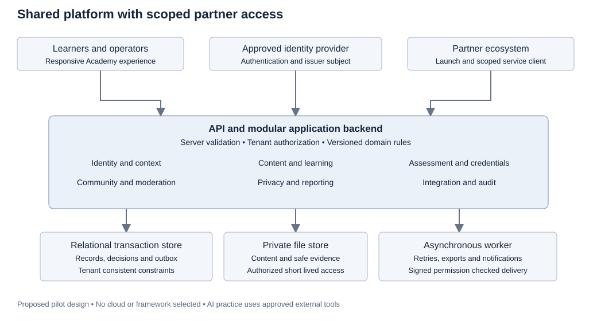

# Aplyd Academy High Level Design

This proposed architecture supports a shared capability platform with tailored partner experiences. It is intended for product, architecture, engineering, operations, and partner teams to review before implementation. A modular application, relational transaction store, private file store, and asynchronous worker provide the initial boundary; provider and framework selection remain open.

Version 0.1 dated 5 October 2026. Authority: the BRD discussed in this conversation and [shared baseline](BASELINE.md). Detailed behavior is in [FSD](FSD.md), contracts in [LLD](LLD.md), and release evidence in [test strategy](test-strategy.md). Design proposals do not constitute approved service commitments.

## Product and release boundary

R1 delivers the full learner journey in one pilot ecosystem: direct or partner entry, role and language selection, catalog, enrollment, resumable learning, practical assessment, feedback and appeal, verifiable private-by-default credentials, moderated cohort discussion, and authorized reporting. A common responsible AI foundation adapts exercises to farmers, MSME owners, bureaucrats, and other supported roles.

R2 adds diagnostics, recommendations, live scheduling, selected offline content, professional networking, mentoring, refreshers, and commercial access. R3 may introduce an embedded AI assistant after separate quality, information-handling, operating-cost, and safety design. The system does not require a model provider to deliver R1 AI training.

## System context

Learners use the responsive Academy web application or enter through a partner's learning link. Trainers, assessors, moderators, content reviewers, and administrators use role-appropriate screens in the same application shell. An identity provider authenticates users. The Academy authorizes each action; successful authentication does not itself establish a tenant role.

Partner platforms connect through an identity adapter and permissioned enrollment or achievement APIs. Messaging providers carry notifications containing minimal information. Approved external AI tools may be used in synthetic learning exercises; real tenant records are not forwarded automatically.

## Logical components

| Component | Responsibility | Principal boundary |
|---|---|---|
| Responsive web client | Learner and operator journeys, accessible forms, local draft indicators | Untrusted client; cannot authorize or mark authoritative completion |
| API entry and application backend | Session verification, request validation, policy checks, domain orchestration | Server derives tenant and actor from trusted credentials and membership |
| Identity and context module | External identity links, profile, memberships, context selection | Global account identity separated from tenant permissions |
| Catalog and content module | Reviewed content, immutable published versions, tenant offerings | Draft access differs from published discovery |
| Learning module | Enrollment, cohorts, progress and completion evidence | Each enrollment pins program and assessment policy versions |
| Assessment module | Attempts, rubric scores, decisions, reassessment and appeal | Submitted evidence and historical decisions are immutable |
| Credential module | Award eligibility, issuance, verification and lifecycle | Credentials issued only through authoritative assessment or completion rules |
| Community module | Membership, posts, reports and moderation | Cohort and tenant visibility enforced on every read and write |
| Reporting and privacy module | Scoped reports, personal records, sharing and account requests | No cross-tenant partner aggregation of personal records |
| Integration module | Partner identities, API clients, subscriptions and deliveries | Client scope plus tenant plus permitted purpose |
| Background worker | Outbox delivery, notifications, exports and maintenance | Rechecks current permission for sensitive external delivery |

Modules are logical boundaries within one deployable backend initially. Cross-module writes run through domain services, not arbitrary table updates. Workers may deploy separately but use the same versioned domain contracts.

## Proposed deployment model

Use an edge endpoint for HTTPS, static assets and appropriate public caching; an application deployment for API requests; a relational database for authoritative records; private object storage for evidence and content files; and an asynchronous worker. A queue is optional initially because the transactional outbox can support bounded polling. A cache is introduced only where measured performance warrants it, and cannot be the authoritative record of awards or permissions.

Separate development, test, staging, and production identities, secrets, object stores, and databases. Test environments use synthetic data. Infrastructure configuration and migration history must be reproducible. No production integration credentials belong in documentation or fixtures.

The modular monolith is a proposed pilot choice because enrollment, assessment, and credential consistency benefit from local transactions, and the pilot does not establish a need for independent services. Extract a module when its operational or scaling needs are demonstrably independent. Preserve the existing contract during extraction.

## Identity and tenancy model

An account is a global identity. An external identity is keyed by issuer and subject. Email is contact information and cannot merge identities automatically. A learner profile may contain several role tags; changing from farmer to entrepreneur changes relevant learning, not permissions.

A tenant is a delivery workspace. An ecosystem is a configuration, such as Agri Saha, which may be used by a tenant. Organizations represent tenant-scoped sponsoring bodies. Membership and role assignments specify tenant and, where necessary, organization or cohort boundaries.

Global reviewed catalog versions can be offered in multiple tenants. Offerings, enrollments, cohorts, assessment evidence, decisions, credentials, communities and reports remain tenant-scoped. The direct Academy experience also uses an explicit tenant.

Server policy checks consist of authenticated actor, active membership or allowed personal ownership, permitted action, permitted object scope, and resource state. Client-supplied tenant identifiers are selection inputs, never authority. Foreign-key constraints protect tenant-consistent relationships; application authorization protects access. PostgreSQL row-level policies may be added as defense in depth after the connection-context model is reviewed.

Learners may see their own permitted achievement history across workspaces. Partner administrators cannot use this view to discover other partner records. Membership removal ends tenant-resource access; retained personal achievement visibility is limited to the approved portfolio policy and does not reopen private materials.

## Authoritative learning and assessment flow

1. Enrollment resolves an available offering, checks eligibility and entitlement, and pins the published program version and assessment policy.
2. The client reports activity evidence with a retry key. The server evaluates that activity's completion rule and saves progress.
3. Assessment submission freezes the evidence reference and rubric version. Files must pass the upload safety process before assessors can retrieve them.
4. An authorized assessor records criterion results. A proposed reference pass policy is at least 70 of 100 overall and every critical criterion met; the published program policy is authoritative.
5. Completion is recomputed from mandatory activity evidence and required final assessment. Client percentages cannot override it.
6. Credential eligibility is evaluated, and an award plus outbox event is written atomically. A uniqueness constraint prevents duplicate awards.
7. An appeal records a separate review. If overturned, a superseding decision and any credential action preserve the original history.

Responsible AI critical criteria include verification, information handling, and appropriate human judgment. High task-quality marks cannot compensate for a failed critical criterion.

## Data architecture

The relational database holds identity links, scoped membership, learning state, versioned assessment definitions, decisions, credentials, consent, moderation, delivery state and audit metadata. Private object storage holds content assets and submitted files. Database records contain storage references rather than public storage URLs.

Published content versions and submitted assessment evidence are immutable. Drafts support optimistic concurrency. Reporting reads domain records or a bounded projection with an explicit freshness timestamp. Operational reporting must not silently change enrollment or assessment state.

Every authoritative timestamp is stored in UTC; user interfaces display the learner's selected timezone. Human labels are localized while canonical status codes remain stable. Text must support Unicode. Accessibility metadata, transcripts, language and review status belong to the content model.

Retention categories are defined before launch by business and privacy owners. No permanent-retention duration is inferred merely because credentials need integrity. Deletion and correction processes must account for backups, legal or contractual holds, restricted assessment records, and published credential status.

## Integration architecture

Use approved OIDC identity adapters for browser federation and scoped partner API credentials for server calls. Deep links carry a valid offering or invitation reference and an allowlisted return target; they must not expose sensitive identity context in query strings.

State-changing partner requests use idempotency keys. An outbox entry is committed with the domain change. Delivery is at least once; consumers deduplicate the event ID. Webhooks are signed, timestamped, permission-checked at send time, and retried with bounded backoff. Dead-letter items require a recorded operational decision before replay. A replay cannot restore revoked sharing permission.

Partner endpoints and field-level exchange rules are in [integration contract](integration-contract.md) and [OpenAPI](openapi.json). Protocol details and partner identity configuration require joint acceptance testing before connection to production.

## Security and trust boundaries

Protect the browser-to-backend, backend-to-database, file-store, identity-provider, partner-client and outgoing-webhook boundaries. Deny by default. Enforce server-side authorization on objects, lists, exports, assets and background jobs, not only visible screens. Redact logs and never include assessment documents or access tokens in monitoring payloads.

Public credential verification is token-based, learner-enabled, rate-limited and minimal. A revoked or expired award must never appear active because of stale cache. Moderators can act only within their communities. Privileged support access requires a reason and an audit record.

Detailed threats, information classifications and release gates are in [security and privacy](security-and-privacy.md).

## Availability and proposed performance envelope

Pilot hypotheses are 1,000 monthly active learners, 100 concurrent sessions, 10 requests per second steady, and 30 per second for a five-minute burst. Proposed p95 interactive API reads are 800 ms excluding media and partner latency. First meaningful learner content should appear within 3 seconds on the agreed simulated network. The network profile must be selected before measurement; the number alone is not a reproducible test.

Provisional availability is 99.5 percent monthly excluding agreed maintenance. Pilot recovery hypotheses are RPO 24 hours and RTO 8 hours. These targets require budget, restore testing and stakeholder agreement; they are not an SLA.

Media failure should leave text alternatives available where provided. Notifications and partner delivery can lag without invalidating recorded learning. Database failure must not produce a successful authoritative submission response. Retry after a lost response must retrieve the original submission result.

## Observability and operations

Correlate API request, domain action and partner delivery IDs. Monitor authentication errors, authorization denials, submission failures, assessor backlog, credential failures, outbox lag, delivery failures, unsafe-file detections and moderation backlog. Aggregate indicators should not expose raw learner content.

Audit important changes to membership, content approval, policy versions, assessment decisions, credentials, permissions, replay and data export. Observability logs and security audit records have distinct purposes and access policies.

Restore exercises must validate both records and associated file references. Deployments must handle migration compatibility, worker version compatibility, rollback and temporarily delayed partner events. See [operations runbook](operations.md).

## Architectural decisions and implementation handoff

The [decision register](decisions-and-roadmap.md) records proposed choices and open dependencies. Approve the tenant model, assessment policy, credential claims, first integration and privacy rules before final physical design. The LLD must continue to enforce this HLD's version pinning, scoped access, historical integrity and transaction rules.

An engineering build starts from the agreed R1 backlog, dictionary, schema and API contracts. Release requires executed evidence from the planned unit, integration, smoke, regression, security, accessibility, resilience and UAT suites. Documentation checks cannot substitute for those product tests.

## Functional module handoff map

This map connects FSD modules with the proposed architecture and dictionary. Exact operations and transaction rules are in the LLD and OpenAPI draft; future-release entities are logical extensions rather than R1 SQL tables.

| FSD module | Architectural owner | Principal records | Release |
|---|---|---|---|
| F-01 Identity and context | Identity module and identity adapter | account, external_identity, learner_profile, membership, role_assignment, agreement_acceptance | R1 |
| F-02 Discovery and enrollment | Catalog and learning modules | program_version, offering, cohort, enrollment | R1 catalog; R2 diagnostic and recommendation |
| F-03 Learning and cohorts | Learning module | program_activity, activity_progress, enrollment, cohort | R1; live_session and offline_package later |
| F-04 Responsible AI practice | Content and assessment modules | competency, program_competency, rubric_criterion, submission | R1 practice; optional assistant R3 |
| F-05 Assessments and appeal | Assessment module | assessment_version, attempt, submission, criterion_score, assessment_decision, appeal | R1 |
| F-06 Credentials | Credential module | credential, credential_event | R1 lifecycle; renewal_rule R2 |
| F-07 Community and networking | Community module | community, community_membership, post, moderation_report, moderation_action | R1 cohort; mentor and connection entities R2 |
| F-08 Content and administration | Content module and policy services | program, program_version, program_activity, organization, role_assignment, audit_event | R1 |
| F-09 Ecosystem integration | Integration module and worker | partner_client, webhook_subscription, outbox_event, webhook_delivery, idempotency_record | R1 pilot partner |
| F-10 Privacy support and reporting | Privacy and reporting module | consent_grant, support_ticket, audit_event and scoped reporting projections | R1 |
| F-11 Continuous learning | Content and recommendation services | Future diagnostic_result, recommendation, notification_preference | R2 |
| F-12 Commerce | Entitlement and payment adapter | Future entitlement, transaction | R2 before paid launch |
