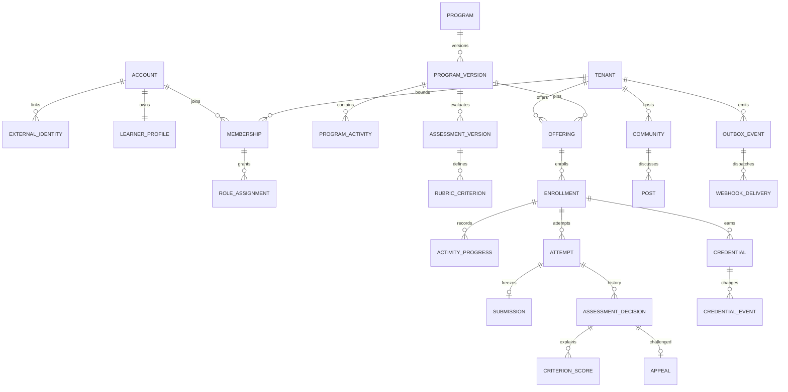

# Aplyd Academy Low Level Design

Version 0.1 · 5 October 2026 · Proposed implementation specification, not a deployed or approved system.

This document specifies the implementation of R1 behavior in [FSD.md](FSD.md) using the architecture in [HLD.md](HLD.md) and canonical decisions in [BASELINE.md](BASELINE.md). The [OpenAPI contract](openapi.json), [SQL reference](schema.sql) and [column dictionary](data-dictionary.csv) are companion implementation artifacts. R2 and R3 are extension boundaries; they are not represented as working functionality.

## 1. Design scope and assumptions

R1 serves adults through responsive web, direct identity and one partner identity integration, selected languages, self-paced and facilitated learning, practical assessment, independent appeals, evidence-based credentials, moderated community, privacy/support, reporting and one authorized achievement exchange. There is no embedded AI assistant, payment, offline submission or open professional directory in R1.

The proposed baseline is a provider-neutral modular monolith: a web interface, application API, relational transactional store, private object storage, identity adapter and asynchronous worker. Framework, hosting, identity provider, runtime, data residency and production database version are decisions still to be made. PostgreSQL-compatible SQL and TypeScript-shaped pseudocode describe contracts; they do not imply an established stack.

The reference schema contains 41 tables and 432 columns. Besides canonical baseline entities, it includes relational bridges `program_competency`, `criterion_score`, `webhook_subscription` and `agreement_acceptance`. The latter keeps required service/community agreements distinct from optional sharing consent. The API contains 100 operations over 87 paths with 136 named schemas. All mutations remain subject to domain authorization, even when a client is generated from the contract.

## 2. Module ownership and service contracts

Each module owns its writes. Cross-module operations use domain commands inside the monolith transaction or versioned outbox events. Controllers cannot update another module's tables directly. Read projections may join authorized tables through reviewed repositories.

| Functional module | Application services | Owned state | Primary contract |
|---|---|---|---|
| F-01 Identity and context | IdentityService, ProfileService, MembershipPolicy | account, external_identity, learner_profile, membership, role_assignment, agreement_acceptance | Verified account linkage, private profile and scoped contexts |
| F-02 Discovery/enrollment | CatalogQuery, EnrollmentService | offering, cohort, enrollment | Visible published offering, one enrollment, pinned version/policy |
| F-03 Learning/cohorts | ProgressService, ResourceAccessService | activity_progress | Resumable position and server-checked completion |
| F-04 Responsible AI practice | EvidenceValidator, ResponsibleUsePolicy | Typed process evidence within attempt/submission; approved rubric definitions | Task quality plus verification, information handling and judgment |
| F-05 Assessment/appeal | AttemptService, ReviewService, AppealService | assessment standards, rubric, attempt, submission, decisions, criterion_score, appeal | Frozen evidence, computed result, immutable supersession |
| F-06 Credentials | CredentialService, VerificationQuery | credential, credential_event | Idempotent award, status history, minimal opted-in verification |
| F-07 Community | CommunityService, ModerationService | community, community_membership, post, moderation_report/action | Membership-bounded discussion and reasoned moderation |
| F-08 Content/admin | ContentService, PublicationService, TenantAdminService | competency, program/version/activity, mappings, tenant, ecosystem, organization | Accountable drafts and immutable published standards |
| F-09 Integration | PartnerPolicy, SubscriptionService, DeliveryWorker | partner_client, subscriptions, webhook_delivery | Tenant/purpose/field-bounded exchange |
| F-10 Privacy/support/reporting | ConsentService, ExportService, SupportService, ReportQuery | consent_grant, support_ticket | Revocable optional sharing; scoped records and aggregates |
| Cross-cutting | AuditWriter, IdempotencyService, OutboxDispatcher | audit_event, idempotency_record, outbox_event | Transaction integrity and reliable at-least-once side effects |
| F-11/F-12 | Extension interfaces only | R2 logical entities in dictionary | Continuous-learning extensions and commerce introduced separately |

R1 next-pathway discovery uses the existing authorized catalog. Personalized recommendation records, live scheduling, networking, mentoring, renewals and entitlements require R2 changes. No billing role may influence rubric scoring.

### Internal command envelope

```typescript
interface ActorContext {
  principal: { type: 'person' | 'partner' | 'service'; key: string };
  accountId?: UUID;
  tenantId?: UUID;       // independently resolved and validated
  tokenAudience: string;
  correlationId: string;
  authenticatedAt: Instant;
}
interface Command<T> {
  actor: ActorContext;
  payload: T;
  idempotencyKey: string;
  expectedRevision?: number;
}
interface DomainEvent<T> {
  event_id: UUID;
  event_type: string;
  version: number;
  occurred_at: Instant;
  tenant_id: UUID;
  subject: { type: string; id: UUID };
  payload: T;            // minimal allowlisted fields or reference
}
```

Role grants, ownership and current consent are resolved from trusted storage at execution time. Caller-supplied claims and UI state cannot populate an authoritative permission set. Service actors have narrowly scoped runtime permissions and cannot impersonate arbitrary learners.

## 3. Authentication and authorization

### 3.1 Identity boundary

Browser authentication uses the selected managed identity adapter and validated OIDC identity. The adapter validates signature, issuer, audience, expiry and appropriate nonce/state or PKCE arrangements for the chosen browser flow. Issuer and subject are the identity key; email is a contact attribute. Exact OIDC integration behavior must be finalized with the provider using the [OIDC Core specification](https://openid.net/specs/openid-connect-core-1_0.html).

`external_identity` has a unique `(issuer, subject)` pair. Linking requires fresh proof of the current account and target identity. In a transaction, lock any matching identity, verify ownership and insert only if unlinked. Unique collisions return 409 and a support route; they never merge two accounts automatically. Disabled accounts and memberships remain ineffective even when the identity provider issues a valid token.

Direct onboarding writes account, identity link, adult-attested profile, required terms agreement and direct-tenant membership atomically. The default goal is an explicit “Explore” choice if no specific goal is selected. Service terms version must match the text presented. Passwords and recovery secrets stay in the identity provider. Recovery returns a generic acknowledgement, with rate limits and no account-existence disclosure.

Partner tokens are validated for the partner API audience, client identity and scopes. A client is bound to exactly one tenant and approved purposes in `partner_client`; caller body fields cannot broaden that binding. Partner enrollment POST resolves verified issuer/subject only from its authenticated body, then returns `learner_ref` as the Academy-generated opaque membership UUID. Achievement GET accepts that reference, never issuer/subject or contact data in the URL. Resolution joins membership in the client-bound tenant and current grant for this client, purpose and resource; the reference itself grants no access. R1 reuses membership ID as the opaque reference instead of adding a separate alias table; distinct per-client alias rotation can be an extension if required. Person tokens and client-credentials tokens are distinguished by principal type and cannot substitute for each other.

### 3.2 Authorization order

Every protected operation performs:

1. Validate authentication and account/client enabled status.
2. Resolve tenant from permitted context or bound partner client.
3. Check active membership or service/client authority.
4. Load the object using `(tenant_id, id)` or an authorized global-content repository.
5. Check ownership or current grant, including organization/cohort scope.
6. Check assignment/conflict-of-interest rules.
7. Check purpose, field allowlist and active sharing authorization where applicable.
8. Execute state/eligibility rules and audit significant effects.

For absent and out-of-scope objects return 404. Use 403 only where the caller is already entitled to know the object exists. Read paths, downloads, exports, lists, search and aggregates follow the same boundary as writes.

### 3.3 Permission matrix

| Operation | Required authority | Additional condition |
|---|---|---|
| Own profile and role-tag edit | Person account owner | Tags never create permission grants |
| Enroll/learn/submit/appeal | Active tenant learner | Own enrollment; permitted offering; current lifecycle policy |
| Read cohort participation | Facilitator grant | Assigned cohort only; no unrelated evidence |
| Draft/finalize assessment | Assessor grant | Assigned attempt; not learner; clean submitted evidence |
| Resolve appeal | Assessor grant | Assigned independent reviewer; differs from learner and original decision maker |
| Draft content | Content-author grant | Program/competency owner and authoring tenant |
| Publish content | Content-review grant | Authoring tenant, assigned reviewer, independent of author |
| Change credential status | Tenant administrator with configured issuer authority | Award issued by this tenant; reason; relevant eligibility review |
| Sponsor report | Organization administrator | Offering belongs to assigned organization; authorized metrics only |
| Ecosystem administration | Ecosystem/tenant administrator | R1 grant is tenant bounded; ecosystem configuration is not a separate security boundary |
| Moderate community | Moderator grant | Assigned cohort/community; designated community owner or matching cohort scope |
| Partner achievement access | OAuth scope plus approved purpose | Bound tenant; linked learner; resource grant and field allowlist |
| Public verification | No login | Valid high-entropy token, explicit sharing choice, effective current status |
| Support/operator access | Explicit support/runtime authority | Assigned case and purpose; audited privileged access |

R1 role scopes support organization and cohort. A separate ecosystem-specific role scope is not modeled; add it explicitly if operational requirements demand it. A broad ecosystem administrator is still confined to its tenant. Administrators do not receive arbitrary private profile or submission access by virtue of configuration authority.

### 3.4 Repository and database controls

Tenant repositories require immutable `ActorContext` and a tenant predicate; there is no unscoped `findById()` exposed to business controllers. Example:

```sql
SELECT e.*
FROM enrollment e
JOIN membership m
  ON m.tenant_id = e.tenant_id AND m.account_id = :actor_account
WHERE e.tenant_id = :authorized_tenant
  AND e.id = :enrollment_id
  AND m.status = 'active'
  AND e.learner_account_id = :actor_account;
```

Staff variants additionally join current grants and assignment predicates. Composite FKs enforce tenant-consistent relations and version-consistent curriculum links. They do not enforce read permissions, current membership status or assessor independence. PostgreSQL constraints follow the [official constraints documentation](https://www.postgresql.org/docs/current/ddl-constraints.html).

Before deployment, define database roles, restricted application grants, append-only permissions, publication mutation guards and RLS policies using transaction-local validated identity. Pool connections must reset context between requests. An unrestricted owner connection must not run application queries. The reference SQL does not pretend that an arbitrary connection variable or permissive RLS policy establishes a secure runtime.

## 4. Persistence model and consistency

### 4.1 Relationship summary



### 4.2 Storage rules

- IDs are service-generated UUIDs; dates are UTC `timestamptz`. No timezone-local database timestamps determine deadlines.
- Program version, activity and assessment references are pinned at enrollment. Offering-specific submission windows are included in the enrollment policy snapshot.
- Published program titles, summary, audience, rules and review dates are versioned. A new title or policy creates a new draft version.
- JSON columns are validated against named domain schemas. They are not arbitrary permission/configuration stores.
- `attempt.learner_draft` is private owner-editable evidence before submission; `review_draft` is assigned-assessor-only unfinished scoring. Neither is a finalized decision.
- Submission object pointer, checksum, media type, scan result and structured process evidence are private. The object itself is not stored in relational text.
- Decisions and criterion scores are immutable. `attempt.current_decision_id` is a projection updated only with a valid new decision.
- Credential events and audits are append-only; current credential status/display fields are projections.
- `enrollment.completed_at` stores the last verified completion instant. It may be retained when a later suspension invalidates current standing; historical completion does not imply current eligibility.
- No cascade deletes are included. A governed purge job must respect approved retention and remove dependent records in a reviewed order.

The CSV covers all physical columns. R2 logical entities are listed separately in [data-dictionary.md](data-dictionary.md); they are not implemented in the R1 DDL.

### 4.3 Cross-row domain invariants

SQL checks alone cannot prove complete rubric coverage, critical gates, credential provenance, draft ownership, consent-resource ownership or quorum-style capacity. The corresponding service must enforce these inside a transaction. Particularly:

- An assessment standard must belong to the pinned program and allowed snapshot.
- All criterion scores belong to the same published standard and appear once.
- A credential's qualifying decision belongs to its enrollment and is currently effective.
- Optional FK values must refer to same-tenant eligible records, despite SQL's nullable composite-FK semantics.
- A consent resource belongs to the learner and recipient's tenant; grant fields are an approved subset.
- The original decision and its replacement form an acyclic history within one attempt.
- A parent post and reply remain in the same community.

## 5. API conventions

The machine contract targets **OpenAPI 3.1.0** for compatibility, following the [official specification](https://spec.openapis.org/oas/v3.1.0.html). It is not a claim about the latest version or a live API.

- Base path `/api/v1`; JSON requests/responses; opaque UUIDs; UTC RFC3339 timestamps.
- Cursor pagination uses opaque signed or server-held cursors binding tenant, principal, filter set and ordering. Default 25, maximum 100. Tampering or changed scope is rejected.
- Error shape: `code`, `message`, `correlation_id`, `field_errors[]`.
- Mutable drafts and conflicting updates use quoted positive revision ETags and `If-Match`.
- Every retryable mutation requires `Idempotency-Key`; fresh authorization is checked even on replay.
- Creation returns 201; asynchronous requests 202; successful update 200. Domain duplicate creation may return the original committed 201 representation for the same idempotency key.
- Unauthorized/out-of-scope 404; disclosed forbidden action 403; malformed input 400; state/body conflict 409; stale revision 412; unmet prerequisite 422; throttled 429; transient failure 503.
- 429 includes `Retry-After`. Error strings do not expose SQL, identities, tokens or evidence.
- Authenticated private responses and verification responses use appropriate no-store cache controls. Signed resources use short-lived access and private cache policy.
- Idempotency, verification token, identity assertion and private query identifiers are redacted from access logs.

HTTP conditional-request semantics follow [RFC 9110](https://www.rfc-editor.org/rfc/rfc9110.html). A same-key replay returns the original committed result after authorization; a new operation against a stale revision returns 412. For activity mutation, `If-Match` is the parent program-version revision, explicitly returned with the resource. Activity rows themselves are immutable after publication and have no independent revision column.

Representative error:

```json
{
  "code": "BUSINESS_RULE",
  "message": "Assessment evidence is incomplete.",
  "correlation_id": "req_synthetic_001",
  "field_errors": [
    {"field": "process_evidence.checks", "code": "REQUIRED_EVIDENCE", "message": "Record the checks performed."}
  ]
}
```

A failed critical criterion is normally a valid finalized **failed assessment**, returned with 201 decision, not an API validation error. 422 applies to an invalid request or attempted credential issue without eligibility. The generic 422 example in the OpenAPI component illustrates business-rule failure, not an override of legitimate assessment outcomes.

## 6. Publication and content transactions

1. Author creates program and draft version in its authoring tenant.
2. Draft records outcomes, audience, summary, language, activities, competency levels, responsible-use evidence requirements and intended credential standard.
3. Author creates assessment identity and version, rubric, upload policy and retry/appeal policy.
4. Author submits review; administrator assigns an independent content reviewer.
5. Reviewer validates content and assessment and publishes the assessment before the program version.
6. Program publication validates all links and freezes version content.
7. A tenant administrator creates an offering referencing that version, then opens it.

Publication validation includes:

- Title 3–160 characters; summary 20–2,000; at least one outcome and audience tag; supported language.
- Every required resource exists, is approved and has an accessible supported-language alternative.
- Activity order and prerequisite graph are acyclic; dependencies refer to the same version.
- Required assessment references match the program version.
- Rubric points total exactly 100 in this reference model; each criterion has positive maximum, unique code and an appropriate dimension.
- All required responsible-use dimensions are covered; declared critical criteria have valid thresholds.
- Passing percentage is within 0–100; retry and appeal policies have explicit limits.
- Published upload media types/size fit the supported security envelope.
- Credential kind accurately reflects evidence; named issuer/standard is defined.
- Independent reviewer and future review date are recorded.

Transaction locks the draft/version, checks ETag and ownership, writes publication facts and audit/outbox, and commits. Afterwards application privileges/guards reject all content mutation to that publication. Retirement stops new offerings as governed; it does not delete referenced evidence. Emergency removal of an unsafe resource provides a support/remediation path, not fabricated activity completion.

## 7. Enrollment, capacity and lifecycle

### 7.1 New enrollment transaction

```text
authorize learner or bound partner enrollment purpose
begin transaction
  lock offering; require open, published version and current enrollment window
  require active learner membership, required terms, adult eligibility and prerequisites
  if existing enrollment for tenant+learner+offering: return existing allowed representation
  if cohort:
    lock cohort; require cohort.offering = offering and eligible state
    count invited unexpired + active + suspended reservations under approved policy
    reject full capacity
  copy published completion/assessment rules + offering submission window
  insert enrollment(active for direct acceptance; invited for authorized partner invitation)
  set explicit invitation expiry when invited
  append audit and outbox
  commit idempotency result with domain transaction
commit
```

The cohort lock serializes seat reservation. Completion releases a seat only if the approved cohort policy says so; the default pilot definition must be decided before launch. Expired invitations cannot reserve capacity forever. SQL's learner/offering unique key prevents duplicates across different idempotency keys.

### 7.2 Enrollment transitions

| From | To | Actor/guard | Effect |
|---|---|---|---|
| invited | active | Intended learner; unexpired; current eligibility/capacity | Accept invitation; maintain pinned snapshot |
| invited | withdrawn | Intended learner or authorized administrator | Decline/cancel; preserve historical invitation |
| active | completed | CompletionService only | All mandatory activities and required current passing assessments |
| active | withdrawn | Learner; confirm consequences | Stop new progress/submission; preserve history |
| active/completed | suspended | Authorized administrator or adverse eligibility command | Stop further work/standing as defined; reason and audit |
| suspended | active | Authorized administrator after remediation | Re-evaluate eligibility; no automatic passing |
| suspended | completed | CompletionService after restored evidence | Restore current completion only when all gates met |
| completed | completed | Idempotent recomputation | No duplicate completion event |

Withdrawn enrollment is not silently reactivated. Whether to support reinstatement or a new offering is a governed product decision. Public achievement views are never inferred solely from a historical completed timestamp.

## 8. Progress and completion algorithm

The browser sends position and evidence with `request_completion`. It does not send an authoritative percentage or completed flag. Progress starts at `not_started`; its initial ETag is supplied with the activity view even if the physical row is lazily created.

```text
saveProgress(context, enrollmentId, activityId, request, expectedRevision):
  authorize own active enrollment
  begin transaction
    lock enrollment
    load activity from enrollment.program_version_id
    verify dependencies and current resource availability
    load/create unique progress row; check expected revision
    preserve already completed state; reject incompatible reset
    validate position against resource bounds
    store latest safe resume position and typed evidence
    if request_completion:
      evaluate published rule using server evidence
      if rule unmet: reject with specific unmet fields; do not complete
      set completed_at = server clock; state = completed
    else if state == not_started: state = in_progress
    increment revision
    recomputeCompletion(enrollment)
    write outbox/audit as needed
    store idempotent result
  commit
```

Video position or acknowledgement may establish lesson participation under the published rule; it never establishes competence. `assessment_pass` activities are completed only by assessment-domain evidence.

`recomputeCompletion` selects mandatory activity IDs from the pinned version and required assessment IDs from the snapshot. Every mandatory activity must be completed. For each required assessment, the latest finalized eligible attempt must have a current passing decision; no pending adverse qualification review may exist. A required assessment activity can be satisfied by that same passing decision. Empty required assessments mean an explicitly non-assessed completion program, not inferred competence.

Retries after a pass are blocked by default. When an older appealed decision is overturned while a newer retry is still active, completion/award waits for resolution of the newer attempt or an authorized, audited voiding of the duplicate attempt. The definitive attempt-selection policy must be approved and published; the default here avoids choosing whichever historical result is most convenient.

Completion transition, event and eligibility scheduling are atomic. The actual credential may arrive asynchronously and the UI displays pending issuance until an award exists.

## 9. Assessment evidence and attempt management

### 9.1 Typed evidence

Responsible-use evidence contains task, audience, input classification, instructions, generated draft, checks, source references, identified errors, revised output and final judgment. Synthetic material is the default. A learner may appropriately decline AI use: generated draft can be empty while final judgment explains the suitability decision. Source URLs are recorded as evidence and are not automatically fetched by the server.

Learner draft saves allow incomplete fields and cannot submit or award credit. Final submission requires complete structured evidence appropriate to the assessment. Human scoring determines the quality of those statements; server completeness does not establish truth.

### 9.2 Private upload flow

1. Owner requests upload authorization against a draft attempt with media type, bytes and SHA-256.
2. API checks published limits and creates a short-lived upload capability bound to account, tenant and attempt.
3. Browser uploads to private quarantine storage; capability cannot list/read unrelated objects.
4. Inspection checks actual size/type/hash and scans the object. Claimed media type is insufficient.
5. Submit request references upload ID and includes frozen process evidence/declaration.
6. Server verifies owner, capability expiry, object metadata and clean scan before submission.
7. Freeze object/version and persist submission plus attempt transition atomically.
8. Authorized reviewer receives a short-lived private download only after reassessing assignment.

Provisional API envelope: PDF, plain text, PNG/JPEG, at most 20 MiB; assessment policy may set lower limits. These are proposal defaults to validate with the pilot, not irreversible product requirements. Scan pending returns conflict; rejected material follows remediation rather than being silently accessible. Abandoned quarantine objects are removed by a governed cleanup schedule.

Upload capability binding/expiry is held in private object metadata and signed capability state, not treated as a public database resource. Object deletion is coordinated with DB state; failed DB submission never publishes a quarantine artifact.

### 9.3 Attempt transitions

| From | To | Guard |
|---|---|---|
| none | draft | Published standard permitted by enrollment; allowance available; no nonterminal attempt |
| draft | submitted | Owner; window open at server receipt; valid frozen clean evidence |
| submitted | under_review | Assigned independent assessor claims with current revision |
| under_review | passed/failed | Complete validated rubric and computed outcome |
| draft/submitted/under_review | voided | Authorized exceptional process with reason; learner cannot erase evidence |
| passed/failed | passed/failed | Only append-only appeal supersession; never overwrite a prior decision |

Attempt creation locks enrollment and relevant attempt set, calculates next number and checks max attempts. Partial unique index prevents multiple nonterminal attempts. A voided attempt's retry-count treatment is a published policy decision; it is not an accidental bypass.

Owner draft uses `learner_draft`; assessor draft uses `review_draft`. Each is revision-guarded and returns only to the proper principal. Finalization freezes evidence and writes separate immutable records; deleting draft data later does not delete the decision.

## 10. Decision computation and critical gates

Clients supply criterion ID, points and rationale; they cannot set total, passed or critical_passed.

```text
evaluateDecision(standard, submittedScores):
  require submitted criterion set == published criterion set
  require every criterion occurs once and has rationale
  for each criterion:
    require 0 <= points <= max_points
  require sum(max_points) == 100
  total = round(sum(points) / sum(max_points) * 100, 2)
  criticalPassed = every critical criterion has points >= critical_min_points
  passed = total >= standard.pass_score AND criticalPassed
  return immutable decision(total, criticalPassed, passed, scores, feedback)
```

Use decimal arithmetic and compare against the unrounded normalized value before presentation rounding, to avoid a displayed 70.00 derived from 69.995 accidentally passing a 70 threshold. Stored/displayed percentage is rounded; eligibility uses exact points and maxima. With the reference 100-point total, comparison is direct, but the service still owns the calculation.

Examples at pass_score 70:

| Total | Critical outcome | Result |
|---|---|---|
| 70 | All met | Pass |
| 95 | One verification/privacy/judgment criterion unmet | Fail |
| 69.99 | All met | Fail |
| 100 | Missing criterion score | Invalid request; no decision |
| 80 | Duplicate criterion or excess points | Invalid request; no decision |

Finalization transaction locks enrollment then attempt, verifies assignment/independence and ETag, writes decision and criterion_score rows, advances current decision/state, recomputes completion, appends event/audit and records idempotent response. A concurrent finalize loses the revision check or receives the original same-key result. It cannot create two contradictory current decisions.

## 11. Appeal processing and downstream consistency

Opening an appeal verifies ownership, challenged decision, published appeal window and unique decision appeal. Exact deadline is `decision.created_at + appeal_window_days`; server clock and approved accommodations determine eligibility. An accommodation is documented and authorized, not a client-controlled timestamp.

| From | To | Guard/effect |
|---|---|---|
| opened | under_review | Independent reviewer assigned |
| under_review | upheld | Reasoned resolution; original current decision remains |
| under_review | overturned | Complete new decision; immutable supersedes link; update current projection |
| upheld/overturned | closed | Recorded learner notification and closure reason; retain resolution_outcome |

`resolution_outcome` persists upheld/overturned after closure. A reviewer must differ from the learner and original assessor, have current scoped authority and access only this case.

On overturn:

1. Lock enrollment, attempt, appeal and dependent awards in consistent order.
2. Reject if the historical challenged decision is no longer the applicable chain head unless an explicit later-decision review process permits it.
3. Write the new evaluated decision referencing the original; do not alter original scores or evidence.
4. Set current attempt decision and result; record resolution.
5. Recompute learner completion and award eligibility.
6. If a previously qualifying award loses eligibility, suspend it immediately in the same transaction with a credential event and reason; schedule issuer review.
7. If eligibility is newly established, enqueue issuance; if a previously suspended award qualifies again, restoration requires issuer authority and validity checks.
8. Write audit and notification/outbox events atomically.

A credential remains suspended pending issuer disposition instead of showing a valid claim during asynchronous review. Revocation is an explicit accountable issuer action. Public verification performs defensive effective-status checks, so delayed expiry/event workers cannot falsely show validity.

## 12. Credential issuance, correction and verification

### 12.1 Idempotent issuance

Award identity is `(tenant_id, enrollment_id, kind, standard_version)`, enforced by a unique constraint. Issuer, standard and claim derive from pinned approved policy, not arbitrary client body fields.

```text
issueCredential(context, enrollmentId, kind):
  authorize configured issuer/service authority
  begin transaction
    lock enrollment and relevant current decisions
    derive standard, issuer, claim and kind-specific evidence
    if existing unique award: return existing without reissuing
    participation: verify declared participation basis
    completion: verify current complete mandatory requirements
    competency: verify current passing assessment AND all critical gates
    generate 256-bit random verification token; store only hash
    insert award(default private) + sequence 1 issued event
    append minimal outbox and audit
    commit idempotency result
  commit
```

The private initial token is not published. First opt-in sharing rotates/generates a token and returns its URL once. Re-enabling after disable rotates again, so an old URL never regains access unintentionally. A lost token may be regenerated through an explicit owner-sharing action.

### 12.2 Lifecycle

| State/action | Result | Rule |
|---|---|---|
| Issue | issued | Evidence and issuer requirements met |
| Suspend | suspended | Issuer reason or immediate adverse eligibility handling |
| Reinstate suspended | issued | Authorized issuer; restored eligibility; not past expiry |
| Revoke issued/suspended/expired | revoked | Accountable reason; terminal in this R1 model |
| Expire issued/suspended | expired | Server-time expiry; restricted history retained |
| Correct display label | Same current status | Learner-approved value; append correction event; preserve evidence |
| Toggle public sharing | Same current status | Owner choice; cannot revive revoked/expired credential |

Revocation is terminal. A separate newly earned award under an approved new standard is possible; silently restoring a revoked award is not. Historical states/events remain available to authorized reviewers under retention policy.

Correction updates only approved display label and related explicitly approved display metadata. It cannot change kind, standard, evidence or original issue date. New evidence requirements use a new standard rather than breaking the unique award identity. Record reason, actor, previous and new permitted values in restricted correction history.

### 12.3 Public projection

Verification hashes the opaque token, loads the credential, confirms public sharing, computes effective expiry/status and returns only issuer, approved learner display label, achievement and current state. Kind, standard and issue/expiry dates remain in the private learner view; effective expiry is represented by status in the minimal public view. Private or unknown token returns indistinguishable 404.

It never exposes scores, submissions, email, account ID or other tenant affiliations. Apply rate limits, redact token path logs and disable shared caching. Status change must be visible even if a worker has not yet rewritten the stored expired state. Partner projections use their separate current consent/purpose allowlist, not the public token route. A privately held credential can be shared with an explicitly authorized partner; disabling a public URL does not revoke an independent partner grant.

## 13. Community and moderation implementation

A community is tenant scoped and optionally cohort scoped. Creating it requires a named moderator owner and current participation rules version. Reading requires current permitted tenant/community membership. Posting additionally requires unmuted status and acceptance of current rules in `agreement_acceptance`.

Root posts require title 5–160 characters; replies may omit title. Body is 10–5,000; safe rendering removes executable markup. A reply's FK includes community ID, preventing cross-community reply references. Content removal keeps a safe tombstone where useful and retains restricted moderation evidence only for its approved period.

A report has one controlled category (`harmful_content`, `misinformation`, `harassment`, `privacy`, `spam`, `other`) and optional detail up to 2,000. Report content does not automatically establish misconduct. Moderator actions are reasoned, append-only records; post/report state transitions occur atomically with audit and notifications. Reporters' private details are not shown to ordinary community members.

R1 does not include a professional discoverability directory, contact matching or durable usefulness reactions. Helpful-response marking is an optional R2 extension with no credential effect. Community invitations cannot bypass enrollment/cohort boundary or reveal private contacts.

## 14. Consent, export, support and reporting

### 14.1 Effective sharing check

```text
canShare(actorClient, learner, resource, purpose, fields, now):
  client is active and bound to resource.tenant_id
  client OAuth scope permits this operation
  purpose in client.approvedPurposes
  learner identity linkage exists and membership permitted
  grant belongs to learner + tenant + client + purpose + resource
  granted_at <= now; not revoked; expiry absent or now < expiry
  requested fields subset of grant.data_fields and platform allowlist
  resource current state permits the disclosed claim
```

`resource_id` is a polymorphic reference checked by PrivacyService, never trusted solely because it is a UUID. Required service terms, community agreements and optional sharing are separate flows. Consent withdrawal commits immediately and invalidates cached sharing decisions. Access grants should not be cached longer than the next protected operation in R1.

### 14.2 Export and account-data requests

Own-record export reauthenticates as needed, selects only the authenticated learner's authorized records, excludes other learners/tenants' private information, creates a private expiring artifact and audits the request. Job ID is an authorized outbox job reference; job ownership follows its subject and caller, and artifact expiry lives in private object metadata. These are asynchronous projections rather than a claim that an export-job table already exists.

Deletion/correction requests enter governed privacy support handling. Retention holds, credential evidence and audit needs are reviewed before disposition. No automatic `DELETE account CASCADE` exists. Removing optional sharing stops future sends; it does not claim to recall previously delivered data.

### 14.3 Support and metrics

Support subject 5–160; details 10–5,000. Staff are assigned through explicit support authority, with minimum necessary case visibility. Intake warns against secrets and unnecessary real-world sensitive records. Administrative closure records resolution through restricted audit/case detail.

Reporting queries join offering organization and authorized grants before counting. Metrics use explicit denominators and date boundaries: enrolled cohort membership, unique learner enrollments, current completion, attempts assessed and passing outcomes. Show period, sample size, scope note and “as of” time in the presentation. Small-group breakdown suppression policy is unresolved and must be decided before sensitive reports launch. Sponsor reports exclude evidence objects and criterion-level scores by default.

## 15. Outbox, idempotency and webhooks

### 15.1 Transactional outbox

Every domain transaction writes state and minimal outbox event together. No network call occurs while holding business-row locks. The dispatcher uses lease-based claims, for example `FOR UPDATE SKIP LOCKED`, with bounded batches. Expired leases can be reclaimed. Published means dispatched into the delivery workflow, not proof of remote receipt.

Event envelope uses stable event_id, event_type, version, occurred_at, tenant_id, subject reference and minimal payload. Consumers deduplicate event_id. Event creation time alone cannot authorize disclosure later.

### 15.2 Idempotency algorithm

```text
authorize current principal/context before lookup
scope = principal + tenant(or direct platform context) + canonical route
hash = SHA256(canonical body + relevant path/query operation inputs)
begin transaction
  insert scoped key or lock existing idempotency record
  if stored hash differs: 409
  if completed: return original committed status/body after current authorization
  execute domain command with relevant row locks and expected revision
  write domain state + outbox + result in this transaction
commit
```

A process crash before commit rolls back command and idempotency result. A crash after commit returns the stored result on retry. Concurrent identical calls wait for or return the same result; they do not both run the mutation. Keys are opaque 16–128 characters and should not contain personal data. Exact retention window is a deployment decision; durable domain unique keys still prevent duplicate enrollment/awards after record expiry.

For resource downloads or regenerated short-lived capabilities, a replayed stored capability may be expired; caller starts a new authorized operation with a new key. Idempotent replay is not permission to mint unlimited access URLs.

### 15.3 Delivery and current consent

One `webhook_delivery` row exists per event/subscription. Before every initial send and replay:

- Confirm active partner, subscription, destination, approved event and purpose.
- Resolve learner/resource and recheck current authorization and field allowlist.
- Suppress if sharing is withdrawn, membership disallowed or resource unavailable.
- Generate the current permitted projection; never replay an old oversized payload.
- Sign timestamp plus exact raw body with a secret-manager key.

Proposed signature: `v1=hex(HMAC-SHA256(secret, timestamp + "." + raw_body))`, using timestamp header and a configurable five-minute receiver window. Key rotation, key ID and partner clock-skew handling require pilot agreement. Secret references are stored; plaintext secrets are not returned by ordinary subscription reads.

Recommended pilot retry envelope, subject to approval: 8 attempts, exponential delay starting at 30 seconds, capped at 30 minutes, full jitter; honor bounded Retry-After where supplied. Retry timeout/network/429/5xx; most permanent 4xx enter controlled failure handling. Stop after bounded attempts and alert accountable operator. Controlled replay retains event identity, records an operator reason, and rechecks all disclosure controls.

The receiver acknowledges only after durably recording event_id and applying or queuing processing. At-least-once delivery can arrive out of order; use occurred_at/event version plus current achievement-query reconciliation rather than blindly restoring an old issued status. Superseded state events never override a later revocation.

### 15.4 Destination security

Subscription initially enters pending. Activation validates HTTPS, recipient ownership, DNS and resolved destination IPs; reject loopback, link-local, private/internal and reserved destinations, unsafe ports and redirects. Recheck DNS/IP on send to resist rebinding, restrict worker egress and cap response/body/time budgets. No arbitrary callback execution occurs from these design artifacts.

## 16. Concurrency, failures and recovery

- Lock creation flows in offering/cohort order; lock existing-learning flows in enrollment → attempt → appeal → credential order. Multiple rows of the same type are locked by ascending ID.
- Retry serialization/deadlock failures only within a bounded request budget, with the same idempotency context and fresh authorization. Never replay arbitrary external calls inside a transaction.
- Unique constraints are the final arbiter for identity link, enrollment, active attempt, credential identity and event/subscription delivery.
- If a required scan/provider is unavailable, retain draft/pending state and show a truthful error; do not mark submitted/completed.
- If credential worker fails, learner sees pending issuance; replay creates one award.
- If notification fails, decision remains recorded; notification is retried and appeal closure waits for durable notification evidence.
- If partner is unavailable, Academy learning still proceeds; delivery is independently retried.
- If consent revocation races with dispatch, revocation committed before the send authorization checkpoint blocks send. A request already handed to the network cannot be recalled; audit and partner handling explain that limitation.
- If content is retired, historical enrolled versions remain interpretable, while unsafe resources may be withheld with remediation.
- Backup and restoration must preserve domain state/outbox consistency. Restore drills include redispatch deduplication and rechecking revoked consent, not merely successful database startup.

## 17. Validation and representative limits

All values below are proposal boundaries, reconciled with FSD; published policies may be stricter within the supported envelope.

| Field/rule | Validation |
|---|---|
| Display name | 1–100 characters; no executable rendering |
| Program title / summary | 3–160 / 20–2,000 |
| Supported language/timezone | Server-maintained allowed language list / valid timezone identifier |
| Goals / role tags | At least one goal or Explore; role tags from controlled list; no permissions |
| Search | ≤200 characters; authorized catalog filters |
| Post title/body | Root title5–160; body10–5,000; same-community replies |
| Appeal reason | 20–4,000; published window |
| Support subject/details | 5–160 / 10–5,000 |
| Upload | Published permitted types, hash and bytes; provisional ceiling20 MiB |
| Rubric | All criteria once; positive maxima totaling100; thresholds valid |
| Retry/appeal policy | Reference API max attempts1–20, appeal window1–365 days; selected values published |
| Idempotency key | Opaque16–128 characters; scoped principal/tenant/route |
| Pagination | Default25, max100; scope-bound opaque cursor |
| Verification token | 256-bit random token, base64url representation; only hash stored |

The SQL includes fundamental lengths, positivity, status and FK checks. The API includes request envelope validation. More specific content/state/assignment rules remain domain checks and must have tests. Arbitrary JSON strings do not bypass allowed values.

## 18. Test seams and implementation acceptance

Each service accepts injectable clock, identity verifier, authorization repository, ID/token generator, object gateway and event writer. Unit tests use synthetic data and deterministic fixtures, not live AI/provider calls.

Required domain tests include exact-threshold scoring, critical failures, point bounds, complete criterion coverage, prerequisite graph cycles, policy snapshots, appeal independence, status restoration/expiry, field-scoped consent and role-tag nonauthorization. Integration tests run against real disposable PostgreSQL and private-storage test adapters to verify FK consistency, uniqueness, transactions, locks, rollback/outbox and idempotency races.

Contract tests validate actual responses against [openapi.json](openapi.json), including forbidden fields in public/partner views, typed errors, ETags and cursor boundaries. End-to-end smoke follows enrollment → progress → submit → review → credential → opt-in verification → permitted partner event. Regression includes revoked consent before replay, identity collisions, simultaneous cohort reservation, conflicting assessor finalize, older appeal plus newer retry, clock expiry and revoked membership.

Read [test-strategy.md](test-strategy.md), [test-cases.csv](test-cases.csv), [test-suites.md](test-suites.md) and [traceability.csv](traceability.csv) for planned test evidence. All system tests are **Not run**; generating documentation or parsing JSON is not executing this product.

## 19. R2 extension contracts

- **Diagnostics/recommendations:** Version diagnostic evidence; explanatory reason codes; dismiss/correct preferences; no inferred permission changes.
- **Live sessions:** Tenant/cohort scheduling, accessible participation, attendance evidence, safe join references and cancellation handling.
- **Networking/mentors:** Opt-in discoverability and field selection; mutual requests, blocks, approval, scope/availability; no default contact disclosure.
- **Offline resources:** Signed/versioned content packages and access expiry. Offline private submissions require a separate conflict/authorization design before release.
- **Renewal:** Immutable renewal standard, explicit evidence/window/fee, honest expiry and historical credential continuity.
- **Commerce:** Integer minor-unit money, frozen price/terms, verified provider callbacks, idempotent entitlements and reconciliation; payment never affects passing.
- **Additional ecosystems:** Shared module behavior plus scoped configuration; do not fork assessment/privacy semantics per partner.
- **AI assistant (R3):** Separate quality, data-use, approved-tool, escalation and cost design; no autonomous appeals or credential issuance.

Before each extension, amend the physical schema, API contract, retention schedule, threat model and tests. Logical R2 fields in the dictionary are planning guidance rather than production-ready DDL.

## 20. Verification status and remaining decisions

Local generation checks passed for JSON/CSV parsing, unique operation IDs, local schema-reference resolution, table/column dictionary coverage, existing FK target columns and target uniqueness. The SQL is a reference draft. PostgreSQL is not installed here; no migration, RLS, query-plan, lock/race, purge or product test has been executed. A formal OpenAPI validator and live contract implementation must still be run before approval.

Before engineering begins, confirm identity/provider flow; platform and authoring-admin grants; tenant/cohort capacity and post-completion access; precise attempt/void/deadline/accommodation policy; content reviewer staffing; issuer recognition and authority; initial languages/resources; approved tools; upload limits; mandatory agreement texts; optional sharing purpose/fields; retention/residency; reporting suppression; notification/support channels; partner signature/key rotation/retry contract; selected runtime/database/hosting; and operating budget.

Proposed performance/recovery targets are in BASELINE/HLD and require measurement on the pilot workload. This document supplies concrete implementation contracts while preserving those unresolved business decisions.
